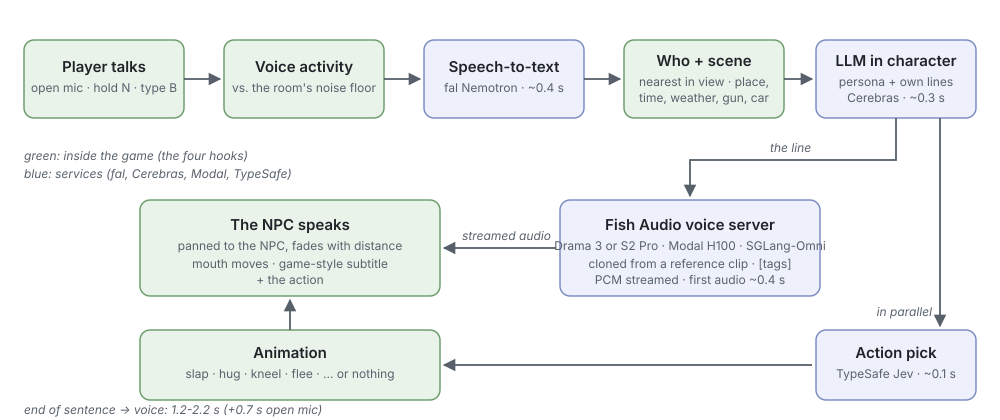

# How it was made

The GTA V example started as one question: can you walk up to anyone in Los Santos, say something out loud, and
have them answer in their own voice, fast enough that it feels like talking? This is how it got built, in order,
with the numbers and the mistakes. An AI coding agent did the building and the measuring; a human played,
listened and decided.

## 1. The budget
Talking feels like talking if the answer starts within about two seconds. Every step had to fit:

| Step | Engine | Time (logged in game) |
|---|---|---|
| Hear the end of the sentence | open mic, 700 ms of quiet ends it | 0.7 s |
| Speech-to-text | fal `nvidia/nemotron-asr-multilingual/asr`, audio inline | 0.38-0.80 s |
| The reply, in character | Cerebras `qwen-3.8-27b`, reasoning off | 0.28-1.0 s (spikes to 5-8 s) |
| What they do | TypeSafe Jev, in parallel | 0.07-0.18 s |
| First audio of the voice | Fish Audio on a Modal H100, streamed | 0.35-0.55 s |
| **From the end of the sentence to the voice** | push-to-talk (the open mic adds its 0.7 s wait) | **1.15-2.2 s** |

The two choices that made it fit: a fast LLM with reasoning off (a reasoning model alone would have blown the
budget), and a voice server that streams, so the NPC starts talking while the rest of the line is still being
generated.

## 2. Voices
A zero-shot cloner needs a clean clip of the voice and its exact transcript. For this private, single-player
build the clips were cut from voice-line compilations of the game's characters; **none of that audio is in this
repo, and the clones aren't either** (rights: `skills/make-npcs-talk/references/safety.md`). The pipeline is
generic and works on any recording you have the rights to (`npctalk voice make`):

1. split the recording into lines at 0.3 s pauses;
2. join runs of neighbouring lines into 6-11 s candidates, scored for normal level, even loudness and no clipping;
3. transcribe each with fal; throw out the ones that turn out to be screams, grunts or another language (too few
   words, or an odd speaking rate);
4. keep the best three as `ref_0..2`, and join the best into a ~25 s `clone.wav`;
5. separate folders for moods: `angry/`, `drunk/`, used when a line starts with `[angry]` or `[drunk]`.

13 characters, 68 clips. Later measurement showed the long `clone.wav` clones better on Drama 3 than any single
clip (0.680 vs 0.610-0.630 voice match), which is why it's the default.

## 3. Hosting Fish Audio
**S2 Pro first.** Fish Audio's S2 Pro was the best open-weights cloner when this started. It ran two ways: on fal,
with a realtime WebSocket (`server/fal/fal_app.py`), and on Modal through SGLang-Omni with a plain streaming HTTP
API (`server/s2pro.py`). The Modal one won on simplicity: `POST /speak {text, voice}` → PCM as it's generated.
Three things made it usable in a game:
- **Prepared voices.** The server encodes every clip in its volume at startup; the game sends a voice *name*. A
  clip sent by URL cost ~9 s the first time.
- **Keep-warm and fallback.** The GPU scales to zero 5 minutes after the last request (it costs ~$4/hour while
  up), and a cold start takes 1-3 minutes. The mod pings the server every 90 s of silence while you play, and
  uses MiniMax on fal (no GPU) while it wakes.
- **Tags.** `[angry]`, `[laughing]`, `[whispering]` at the start of a line steer the delivery, and pick the mood
  clip.

**Then Drama 3.** When Fish Audio released Drama 3 (open weights, 35B mixture of experts with 3B active, FP8,
~37 GB), it went onto its own H100 behind the *same* API (`server/drama3.py`), following SGLang-Omni's Drama 3
cookbook. The game switched by changing one URL. First audio from the PC: ~0.33 s. It acts tags better than S2 Pro
(crying, laughing), and on likeness it ended up level with S2 Pro's best zero-shot result (section 6).

## 4. The mod
A ScriptHookVDotNet script (C#). Most of it doesn't know it's in GTA: the dialogue, the LLM and voice clients,
streaming playback, speech-to-text, the open mic and the action picker build into a console app
(`tools/npcvoice-check`) and were tested there before the game ever saw them. What's left is four hooks
(`skills/make-npcs-talk`):
- **Who:** living humans within 12 m; within 5 m always, 5-12 m only if the camera points at them; named
  characters first; the last partner sticks while within 6 m.
- **Scene:** zone and street, time, weather, the player's car, gun, wanted level, health, "this is their home".
- **Voice at the NPC:** played on the PC (NAudio), panned by where the NPC is on screen, faded with distance,
  the mouth opened with a facial animation while the audio is loud, the line as a subtitle.
- **Actions:** names mapped to animations, tasks and clothing swaps, checked against the game's files at load.

Around them: an open mic that ignores the NPC's own voice coming out of the speakers, push-to-talk and typing,
per-NPC conversation history, hotkeys that take you to the main characters' homes with their families, and a
dev mode (a ring of characters, a target marker, every step's timing).

## 5. Characters that sound like themselves
The first replies sounded like a polite assistant doing an impression. What fixed it:
- **Their own lines in every prompt.** A fresh random 30 of the character's real lines, every call, so they copy
  the slang, rhythm and catchphrases without repeating them.
- **Rules about the shape of a spoken line:** only the words said out loud, one or two short sentences, one
  delivery tag at the start, react to the scene, never sound like an assistant.
- **The game's tone, written down:** GTA's is M-rated, foul-mouthed, roasts you back harder. Another game would
  write the opposite.
- **Doing what they're told.** Jev checks whether the player gave an order *before* the reply is written; if so,
  the LLM writes the line knowing "you're doing it right now", and the NPC complains while complying instead of
  refusing.
- **Cleaning the output:** drop refusals, strip name prefixes and `*actions*`, cap at 45 words, and content rules
  in code (slurs filtered unless a persona opts in; no racial insults or anti-gay slurs from anyone).

## 6. Making the voice sound right (and being honest about it)
"It sounds like him" isn't measurable, so a scorer was built (`server/finetune/train.py`):
- **Voice match:** ECAPA speaker-embedding similarity of each generated line to the centroid of 60 real clips of
  the character that were never used as references.
- **Word error:** Whisper large-v3 against the line's text.
- **Ten test lines** in the character's style, across moods.

Lamar was the test subject. What happened, in order:
1. **Fine-tuning S2 Pro** (LoRA) first produced garbage. Two bugs in fish-speech's trainer for S2 Pro: unscaled
   codebook embeddings, and S1's prompt layout instead of S2 Pro's chat layout. Fixed (`fish_finetune.py`), step
   250 reached **0.785**, the best result of the whole project. But it needs training.
2. **Drama 3, no training.** Lower sampling temperature looked like a big win (0.715 vs 0.637) on one run of ten
   lines. A second identical run gave 0.645. **The first result was luck, and it had already been reported.**
   The correction was posted where the claim was made.
3. More levers, measured properly: all four reference clips at once (no better), single clips instead of the
   long clone (worse), temperature 0.5 and 0.3 (worse, and more rambling takes).
4. **Best of N.** Render several takes, keep the one most like the reference. A first version picked by one
   speaker model (WavLM) and let broken takes through: about 1 take in 10 rambles to the token limit (47.6 s for
   a 15-word line) or trails off, and one demo clip ended up with a 14-second whimper. Checks were added: a length
   cap from the word count, and a small ASR that must hear the line.
5. **A proper study.** Ten single takes per line, every take scored by two speaker models against the reference
   and against the real clips, then every picking strategy simulated on the same takes. Picking by ECAPA plus
   WavLM, among takes that pass the checks, kept most of each model's gain. Deployed and measured directly:
   **0.704**, better than one take on 9 of 10 lines.

| Setup (Lamar, 10 lines) | Voice match | Word error |
|---|---|---|
| ElevenLabs instant clone | 0.612 | 10.5% |
| Drama 3, defaults | 0.643 | 7.1% |
| Drama 3, temperature 0.7 / top_p 0.8, one take (10 runs) | 0.660 | 7.9% |
| S2 Pro, same reference clip | 0.680 | 6.1% |
| **Drama 3, best of 8, checked, two-model pick** | **0.704** | 8.6% |
| S2 Pro, its best single clip | 0.707 | 5.6% |
| S2 Pro fine-tuned on Lamar (training) | 0.785 | 7.5% |

The lessons are in `skills/voice-likeness-eval`: compare per line, run more than twice, report every run, and never
let a picker grade itself.

## 7. Videos
The first showcase used scripted cinematic cameras at the characters' homes. The verdict: "the video is really
bad." It looked like a trailer, not a game. The rebuild (`skills/npc-showcase-clips`):
- **The gameplay camera, held still** behind the player, set every frame; HUD and the game's subtitles on, nothing
  of the mod on screen.
- **Clips, not scenes:** one exchange, 5-10 s, at a street spot or a home, with a time of day; some between two
  NPCs with the player hidden.
- **Render first, then roll:** both voices are rendered before the clip starts and played back to back.
- **Re-voice without rewriting:** approved replies are pinned (`say:` / `do:`), so better voices don't cost the jokes.
- **Re-take, don't cut:** clips whose last line ran past 10 s were re-shot or their line tightened by a few words.
- **Look before sending:** a contact sheet of one frame per clip caught partners hidden in shop doorways and a
  kiosk in the shot; those clips moved spots, and the director now raycasts for a clear view before placing anyone.

## 8. What went wrong (so you don't)
1. **Claiming a result from one run** (section 6). Measure before telling anyone.
2. **The mod was "broken" but switched off.** A toggle key and a notification that vanishes in seconds; the log
   said "nobody near" 755 times. The off state is now always on screen.
3. **Windows refused a new build.** Smart App Control blocked an unsigned DLL; the game ran with no mod at all.
   Test-load each build; keep the last one that loaded.
4. **The keep-warm job died with the laptop's client.** Modal cancels a detached `.remote()` call when its client
   exits; deploy the job and spawn it on the deployed app.
5. **A watch file locked by `tail -F`** on Windows stopped a recording script from logging its video start.
6. **Dependency fights in the GPU image:** protobuf pinned down by an audio library, speechbrain replacing torch,
   ruamel.yaml 0.19 breaking hyperpyyaml (`skills/fish-voice-server/references/gotchas.md`).
7. **GTA pauses when it loses focus**, and so does every script; automation has to bring it to the front, and keys
   must be sent as SendInput scan codes.

## What's next
- Fine-tune Drama 3 on a character and measure it against the S2 Pro fine-tune.
- In-engine positional audio and lip sync for engines that support it (Unity's AudioSource gets it for free).
- A hosted backend behind one key, so players don't need four accounts and a GPU deployment.
- More games: if you make NPCs talk somewhere else, add a field note (`knowledge/`).
